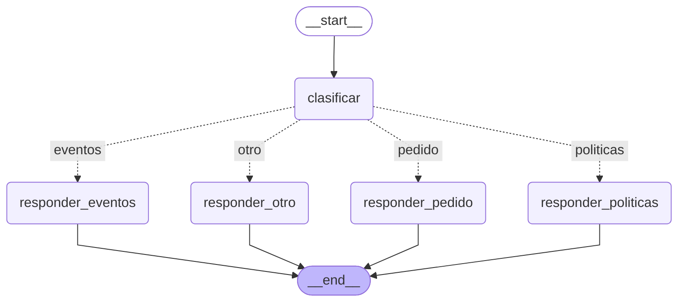
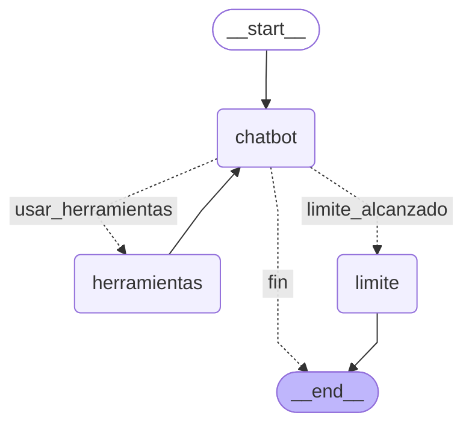

# Entrega — Asistente EventHub como grafo de LangGraph

Generada con `scripts/demo_grafos.py` el 2026-11-15 10:52 con el modelo `gpt-6-luna`, sobre una copia temporal de `data/`.

## 1. Diagramas

### Versión 1 — grafo simple



### Versión 4 — herramientas



## 2. Versión 1 — clasificación por reglas (sin LLM)

| Mensaje | Intención | Respuesta fija |
|---|---|---|
| ¿Qué conciertos hay en Valencia? | `eventos` | Puedo ayudarte con eventos: dime la ciudad, el tipo de evento o el mes que te interesa. |
| ¿Cómo va mi pedido EH-1001? | `pedido` | Para consultar tu pedido necesito su identificador (p. ej. EH-1001) y el email de compra. |
| ¿Puedo devolver mis entradas? | `politicas` | Puedes consultar nuestras políticas de devoluciones, cambio de titular y cancelaciones. ¿Sobre cuál tienes dudas? |
| ¿Qué tiempo hace hoy? | `otro` | No he entendido tu consulta. Puedo ayudarte con eventos, pedidos y políticas de EventHub. También puedes escribir a soporte@eventhub.example. |

## 3. Versión 3 — memoria por hilo

**[hilo-1] Usuario:** Hola, me llamo Laura. ¿Cuál es la política de devoluciones?

**[hilo-1] Asistente:** Hola, Laura. Puedes solicitar la devolución hasta 14 días antes del evento. El reembolso se realiza al mismo método de pago en un plazo de 5 a 10 días hábiles. Los gastos de gestión (1,50 € por entrada) no son reembolsables, salvo si el organizador cancela el evento.

No se aceptan devoluciones a menos de 14 días del evento ni de entradas ya utilizadas. Para solicitarla necesitas el identificador del pedido y el email de compra.

**[hilo-2] Usuario:** ¿Cómo me llamo?

**[hilo-2] Asistente:** No tengo acceso a los datos de tu cuenta o pedido, así que no puedo saber cómo te llamas. Contacta con soporte en soporte@eventhub.example o en el +34 900 123 456.

**[hilo-1] Usuario:** ¿Cómo me llamo?

**[hilo-1] Asistente:** Te llamas Laura.

El `hilo-2` no sabe el nombre porque su estado es independiente del `hilo-1`.

### `get_state` del hilo-1

```text
get_state(thread_id='hilo-1')
  mensajes guardados: 4
  next: ()  (vacío = el grafo terminó el turno)
  checkpoint_id: 1f1e0da4-7881-660d-8004-34d2c23fc95d
  paso: 4
  [1] human: Hola, me llamo Laura. ¿Cuál es la política de devoluciones?
  [2] ai: Hola, Laura. Puedes solicitar la devolución hasta 14 días antes del evento. El reembolso se realiza al mismo método de pago en un plazo de 5 a 10 días hábiles. Los gastos de gestión (1,50 € por entrada) no son reembolsables, salvo si el organizador cancela el evento.

No se aceptan devoluciones a menos de 14 días del evento ni de entradas ya utilizadas. Para solicitarla necesitas el identificador del pedido y el email de compra.
  [3] human: ¿Cómo me llamo?
  [4] ai: Te llamas Laura.
```

## 4. Versión 4 — herramientas encadenadas

### Conversación A: pregunta del enunciado (con email)

**Usuario** (`conv-a`): ¿Mi pedido EH-1003 es para un concierto en Madrid? Si es así, dime otros conciertos en Madrid ese mes. Mi email es ana.gomez@example.com

*Herramientas llamadas en esta respuesta (3, 3 ronda(s)):*
- `consultar_pedido({"id_pedido": "EH-1003", "email": "ana.gomez@example.com"})`
- `buscar_eventos({"ciudad": "Madrid", "categoria": "concierto", "mes": null})`
- `buscar_eventos({"ciudad": "Madrid", "categoria": "concierto", "mes": "2026-12"})`

**Asistente:** Sí. El pedido **EH-1003** corresponde a **Rock en la Gran Vía**, un concierto en Madrid el **11 de diciembre de 2026**.

Otros conciertos en Madrid ese mes:
- **Coros de Navidad en el Retiro** — 19 de diciembre, **25 €**; 80 entradas disponibles.
- **Sinfonía de Invierno** — 27 de diciembre, **55 €**; agotado.

> ✅ El agente encadenó `consultar_pedido` y `buscar_eventos` en la misma respuesta.

**Usuario** (`conv-a`): ¿Cuál de esos es el más barato?

*Herramientas llamadas en esta respuesta (1, 1 ronda(s)):*
- `buscar_eventos({"ciudad": "Madrid", "categoria": "concierto", "mes": "2026-12"})`

**Asistente:** **Coros de Navidad en el Retiro** es el más barato: **25 €**. Hay 80 entradas disponibles.

### Conversación B: sin email (el agente lo pide antes de seguir)

**Usuario** (`conv-b`): ¿Mi pedido EH-1003 es para un concierto en Madrid? Si es así, dime otros conciertos en Madrid ese mes.

*Herramientas llamadas:* ninguna

**Asistente:** Para comprobarlo necesito el email que usaste al comprar el pedido EH-1003. Cuando lo verifique, buscaré otros conciertos en Madrid del mismo mes.

**Usuario** (`conv-b`): Mi email es ana.gomez@example.com

*Herramientas llamadas en esta respuesta (3, 3 ronda(s)):*
- `consultar_pedido({"id_pedido": "EH-1003", "email": "ana.gomez@example.com"})`
- `buscar_eventos({"ciudad": "Madrid", "categoria": "concierto", "mes": null})`
- `buscar_eventos({"ciudad": "Madrid", "categoria": "concierto", "mes": "2026-12"})`

**Asistente:** Sí. El pedido EH-1003 corresponde a **Rock en la Gran Vía**, un concierto en Madrid el **11 de diciembre de 2026**. El pedido figura como pagado.

Otros conciertos en Madrid ese mes:
- **Coros de Navidad en el Retiro** — 19 de diciembre, **25 €**; entradas disponibles.
- **Sinfonía de Invierno** — 27 de diciembre, **55 €**; agotado.

### `get_state` del hilo conv-a

```text
get_state(thread_id='conv-a')
  mensajes guardados: 12
  pasos (último turno): 1
  next: ()  (vacío = el grafo terminó el turno)
  checkpoint_id: 1f1e0da4-f3b7-6250-800c-c41c117461b0
  [1] human: ¿Mi pedido EH-1003 es para un concierto en Madrid? Si es así, dime otros conciertos en Madrid ese mes. Mi email es ana.gomez@example.com
  [2] ai (tool_calls): consultar_pedido({"id_pedido": "EH-1003", "email": "ana.gomez@example.com"})
  [3] tool [consultar_pedido]: {"encontrado": true, "id_pedido": "EH-1003", "id_evento": "EV013", "cantidad": 1, "estado": "pagado", "fecha_compra": "2026-09-30T09:45:00"}
  [4] ai (tool_calls): buscar_eventos({"ciudad": "Madrid", "categoria": "concierto", "mes": null})
  [5] tool [buscar_eventos]: [{"id": "EV013", "nombre": "Rock en la Gran Vía", "ciudad": "Madrid", "categoria": "concierto", "fecha": "2026-12-11T21:00:00", "precio": 38.0, "disponibles": 150}, {"id": "EV014", "nombre": "Coros de Navidad en el Retiro", "ciudad": "Madrid", "categoria": "concierto", "fecha": "2026-12-19T19:00:00", "precio": 25.0, "disponibles": 80}, {"id": "EV015", "nombre": "Sinfonía de Invierno", "ciudad": "Madrid", "categoria": "concierto", "fecha": "2026-12-27T20:00:00", "precio": 55.0, "disponibles": 0}, {"id": "EV016", "nombre": "Pop Madrid Live", "ciudad": "Madrid", "categoria": "concierto", "fecha": "2027-01-22T20:30:00", "precio": 42.0, "disponibles": 200}]
  [6] ai (tool_calls): buscar_eventos({"ciudad": "Madrid", "categoria": "concierto", "mes": "2026-12"})
  [7] tool [buscar_eventos]: [{"id": "EV013", "nombre": "Rock en la Gran Vía", "ciudad": "Madrid", "categoria": "concierto", "fecha": "2026-12-11T21:00:00", "precio": 38.0, "disponibles": 150}, {"id": "EV014", "nombre": "Coros de Navidad en el Retiro", "ciudad": "Madrid", "categoria": "concierto", "fecha": "2026-12-19T19:00:00", "precio": 25.0, "disponibles": 80}, {"id": "EV015", "nombre": "Sinfonía de Invierno", "ciudad": "Madrid", "categoria": "concierto", "fecha": "2026-12-27T20:00:00", "precio": 55.0, "disponibles": 0}]
  [8] ai: Sí. El pedido **EH-1003** corresponde a **Rock en la Gran Vía**, un concierto en Madrid el **11 de diciembre de 2026**.

Otros conciertos en Madrid ese mes:
- **Coros de Navidad en el Retiro** — 19 de diciembre, **25 €**; 80 entradas disponibles.
- **Sinfonía de Invierno** — 27 de diciembre, **55 €**; agotado.
  [9] human: ¿Cuál de esos es el más barato?
  [10] ai (tool_calls): buscar_eventos({"ciudad": "Madrid", "categoria": "concierto", "mes": "2026-12"})
  [11] tool [buscar_eventos]: [{"id": "EV013", "nombre": "Rock en la Gran Vía", "ciudad": "Madrid", "categoria": "concierto", "fecha": "2026-12-11T21:00:00", "precio": 38.0, "disponibles": 150}, {"id": "EV014", "nombre": "Coros de Navidad en el Retiro", "ciudad": "Madrid", "categoria": "concierto", "fecha": "2026-12-19T19:00:00", "precio": 25.0, "disponibles": 80}, {"id": "EV015", "nombre": "Sinfonía de Invierno", "ciudad": "Madrid", "categoria": "concierto", "fecha": "2026-12-27T20:00:00", "precio": 55.0, "disponibles": 0}]
  [12] ai: **Coros de Navidad en el Retiro** es el más barato: **25 €**. Hay 80 entradas disponibles.
```

