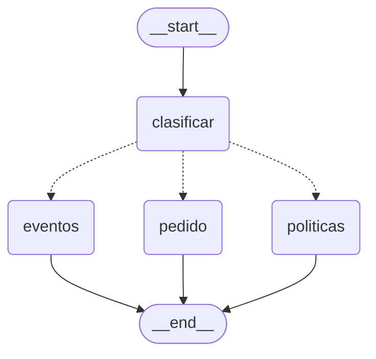
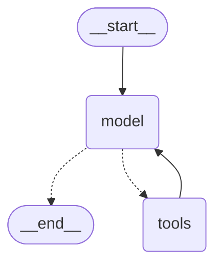

# Tutorial de LangGraph con el Asistente EventHub

Este tutorial explica LangGraph desde cero: qué es un grafo de estado, cómo se definen nodos y aristas, cómo se guarda la memoria, cómo se pausa una ejecución para que una persona decida y cómo se combinan grafos. Algunos ejemplos salen del código de este repositorio y otros son nuevos, construidos con los datos y servicios de EventHub (`events.json`, `services/reservas.py`, las herramientas de `tools/`).

Es la continuación de [tutorial_langchain.md](tutorial_langchain.md). Allí se usa `create_agent`, que **es** un grafo de LangGraph ya montado. Aquí se abre esa caja y se aprende a construir grafos a mano.

> **Versiones usadas:** `langgraph 1.2.20`, `langgraph-checkpoint 4.3.1`, `langchain 1.4.9`, `langchain-core 1.7.6` (fijadas en [requirements.txt](../requirements.txt)). Todos los fragmentos de este documento se han ejecutado con esas versiones y las salidas que se muestran son reales. Si usas otra versión, revisa la API instalada (`help(...)`, `inspect.signature(...)`).

**Cómo ejecutar los fragmentos.** Desde la raíz del proyecto, con el venv activado, guarda el fragmento en un fichero y ejecútalo así:

```bash
PYTHONPATH=. EVENTHUB_DATA_DIR=/tmp/eventhub-data python mi_ejemplo.py
```

- `PYTHONPATH=.` permite importar `services`, `tools` y `llm`.
- `EVENTHUB_DATA_DIR` apunta a una **copia** de `data/` (`cp -r data /tmp/eventhub-data`), para que los ejemplos que reservan entradas no modifiquen `data/events.json`.
- **Ningún ejemplo necesita clave de OpenAI**: donde hace falta un LLM se usa un modelo falso guionizado (sección 7). Para usar el modelo real basta con cambiarlo por `crear_modelo()` de [llm/models.py](../llm/models.py).

## Índice

1. [Qué es LangGraph y cuándo usarlo](#1-qué-es-langgraph-y-cuándo-usarlo)
2. [Primer grafo: estado, nodos y aristas](#2-primer-grafo-estado-nodos-y-aristas)
3. [El estado y los reducers](#3-el-estado-y-los-reducers)
4. [Aristas condicionales: enrutar](#4-aristas-condicionales-enrutar)
5. [Bucles y `recursion_limit`](#5-bucles-y-recursion_limit)
6. [Visualizar el grafo](#6-visualizar-el-grafo)
7. [Un agente ReAct construido a mano](#7-un-agente-react-construido-a-mano)
8. [Memoria: checkpointers y `thread_id`](#8-memoria-checkpointers-y-thread_id)
9. [Human in the loop: `interrupt` y `Command(resume=...)`](#9-human-in-the-loop-interrupt-y-commandresume)
10. [`Command`: actualizar el estado y saltar a otro nodo](#10-command-actualizar-el-estado-y-saltar-a-otro-nodo)
11. [Interrupciones estáticas, `update_state` y viaje en el tiempo](#11-interrupciones-estáticas-update_state-y-viaje-en-el-tiempo)
12. [Streaming](#12-streaming)
13. [Paralelismo: ramas y `Send` (map-reduce)](#13-paralelismo-ramas-y-send-map-reduce)
14. [Subgrafos](#14-subgrafos)
15. [Contexto de ejecución y reintentos](#15-contexto-de-ejecución-y-reintentos)
16. [Cómo encaja todo en este proyecto](#16-cómo-encaja-todo-en-este-proyecto)
17. [Probar grafos sin gastar](#17-probar-grafos-sin-gastar)
18. [Errores frecuentes y buenas prácticas](#18-errores-frecuentes-y-buenas-prácticas)
19. [Ejercicios](#19-ejercicios)
20. [Chuleta](#20-chuleta)

---

## 1. Qué es LangGraph y cuándo usarlo

LangGraph es una librería para construir aplicaciones con LLM como **grafos de estado**:

| Concepto | Qué es | En EventHub |
|---|---|---|
| **Estado** | Un diccionario tipado que viaja por el grafo | La lista de `messages` de la conversación |
| **Nodo** | Una función que recibe el estado y devuelve una **actualización parcial** | `model` (llama al LLM), `tools` (ejecuta herramientas) |
| **Arista** | Indica qué nodo se ejecuta después | `tools → model` |
| **Arista condicional** | Una función decide el siguiente nodo en tiempo de ejecución | Si el modelo pidió herramientas, ir a `tools`; si no, terminar |
| **Checkpointer** | Guarda el estado tras cada paso, por `thread_id` | `InMemorySaver` en [memory/checkpointer.py](../memory/checkpointer.py) |
| **Interrupción** | Pausa la ejecución hasta que alguien la reanude | Confirmación antes de `reservar_entradas` |

### Cadena, agente o grafo

| Necesitas… | Usa | Ejemplo en el proyecto |
|---|---|---|
| Un flujo fijo: prompt → modelo → parser | Una cadena LCEL (`langchain-core`) | [llm/chain.py](../llm/chain.py), endpoint `/politicas` |
| Un agente estándar: el modelo llama herramientas en bucle | `create_agent` (`langchain`), que crea un grafo de LangGraph por ti | [llm/agent.py](../llm/agent.py), endpoint `/chat` |
| Un flujo propio: pasos fijos más decisiones del modelo, ramas en paralelo, aprobaciones en puntos concretos, varios agentes | `StateGraph` (`langgraph`) | Los ejemplos nuevos de este tutorial |

### Cómo se ejecuta un grafo

LangGraph ejecuta el grafo en **superpasos** (inspirado en el modelo *Pregel*):

1. Se ejecutan todos los nodos activos del paso. Si hay varios, en paralelo.
2. Cada nodo devuelve una actualización parcial. Se fusionan en el estado usando los **reducers** (sección 3).
3. Si hay checkpointer, se guarda un **checkpoint** del estado.
4. Las aristas deciden qué nodos se activan en el siguiente paso.
5. Termina cuando no queda ningún nodo activo (se ha llegado a `END`), o se pausa si hay una interrupción.

---

## 2. Primer grafo: estado, nodos y aristas

Ejemplo nuevo: calcular el total de una compra de entradas con un 10 % de descuento a partir de 4 entradas.

```python
from typing import TypedDict
from langgraph.graph import StateGraph, START, END

# 1) El estado: qué datos viajan por el grafo
class Estado(TypedDict):
    precio: float
    cantidad: int
    total: float

# 2) Los nodos: reciben el estado completo y devuelven SOLO lo que cambian
def calcular_total(estado: Estado) -> dict:
    return {"total": estado["precio"] * estado["cantidad"]}

def aplicar_descuento(estado: Estado) -> dict:
    if estado["cantidad"] >= 4:
        return {"total": round(estado["total"] * 0.9, 2)}
    return {}                       # devolver {} = no cambiar nada

# 3) El constructor: se registran nodos y aristas
constructor = StateGraph(Estado)
constructor.add_node("calcular_total", calcular_total)
constructor.add_node("aplicar_descuento", aplicar_descuento)
constructor.add_edge(START, "calcular_total")
constructor.add_edge("calcular_total", "aplicar_descuento")
constructor.add_edge("aplicar_descuento", END)

# 4) Compilar: valida el grafo y devuelve un Runnable ejecutable
grafo = constructor.compile()

print(grafo.invoke({"precio": 35.0, "cantidad": 4}))
# {'precio': 35.0, 'cantidad': 4, 'total': 126.0}
```

Ideas clave:

- **`START` y `END`** son nodos especiales: el punto de entrada y el de salida.
- **Un nodo devuelve una actualización parcial**, no el estado entero. `aplicar_descuento` solo devuelve `total`. LangGraph conserva el resto de claves.
- **No se modifica el estado recibido** (`estado["total"] = ...`). Se devuelve un diccionario nuevo. Mutar el estado de entrada no se guarda de forma fiable.
- **`compile()`** comprueba que el grafo es válido (por ejemplo, que no hay nodos inalcanzables ni aristas a nodos que no existen) y devuelve un `CompiledStateGraph`. Es un *Runnable*, así que tiene `invoke`, `stream`, `batch` y sus versiones `async` (`ainvoke`, `astream`…), igual que las cadenas del tutorial de LangChain.
- La entrada de `invoke` no tiene por qué traer todas las claves: aquí `total` no se pasa y la crea el primer nodo.
- Si el grafo es una simple secuencia, existe el atajo `constructor.add_sequence([calcular_total, aplicar_descuento])`.

---

## 3. El estado y los reducers

### Sobrescribir o acumular

Por defecto, si un nodo devuelve una clave, su valor **sustituye** al anterior. Un **reducer** cambia ese comportamiento: es una función `(valor_actual, valor_nuevo) -> valor_fusionado` que se declara con `Annotated`.

```python
import operator
from typing import Annotated, TypedDict
from langgraph.graph import StateGraph, START, END

class Estado(TypedDict):
    contador: int                                   # sin reducer: se sobrescribe
    pasos: Annotated[list[str], operator.add]       # con reducer: se concatena

def a(estado): return {"contador": estado["contador"] + 1, "pasos": ["a"]}
def b(estado): return {"contador": estado["contador"] + 1, "pasos": ["b"]}

g = StateGraph(Estado)
g.add_node("a", a)
g.add_node("b", b)
g.add_edge(START, "a")
g.add_edge("a", "b")
g.add_edge("b", END)

print(g.compile().invoke({"contador": 0, "pasos": ["inicio"]}))
# {'contador': 2, 'pasos': ['inicio', 'a', 'b']}
```

Cada nodo devuelve `["a"]` o `["b"]`, solo lo nuevo, y el reducer `operator.add` lo concatena a la lista.

> Los reducers son **imprescindibles** cuando dos nodos escriben la misma clave **en el mismo superpaso** (ramas en paralelo, sección 13). Sin reducer, LangGraph lanza `InvalidUpdateError` porque no sabe cuál de los dos valores quedarse.

### `add_messages` y `MessagesState`

Para conversaciones, LangGraph trae el reducer `add_messages`, más listo que `operator.add`:

```python
from langchain_core.messages import AIMessage, HumanMessage, RemoveMessage
from langgraph.graph.message import add_messages

h = [HumanMessage("hola", id="1")]

add_messages(h, [AIMessage("¡Hola!", id="2")])          # id nuevo → se AÑADE
# [HumanMessage('hola', id='1'), AIMessage('¡Hola!', id='2')]

add_messages(h, [HumanMessage("hola, corregido", id="1")])   # id existente → se SUSTITUYE
# [HumanMessage('hola, corregido', id='1')]

add_messages(h + [AIMessage("x", id="2")], [RemoveMessage(id="1")])  # RemoveMessage → se BORRA
# [AIMessage('x', id='2')]
```

Además, acepta diccionarios (`{"role": "user", "content": "..."}`) y los convierte en mensajes. Por eso en [llm/agent.py](../llm/agent.py) basta con:

```python
agente.invoke({"messages": [{"role": "user", "content": mensaje}]}, _config(thread_id))
```

Como el estado de mensajes es tan habitual, existe `MessagesState`, ya definido así:

```python
class MessagesState(TypedDict):
    messages: Annotated[list[AnyMessage], add_messages]
```

Se puede extender con claves propias:

```python
from langgraph.graph import MessagesState

class EstadoEventHub(MessagesState):
    thread_cliente: str
    reservas_hechas: Annotated[list[str], operator.add]
```

> **Conexión con el proyecto.** El docstring de [memory/middleware.py](../memory/middleware.py) explica por qué el recorte del historial **no** se hace devolviendo una actualización de estado: pasaría por el reducer `add_messages` y quedaría guardada en el checkpointer. Se modifica solo la petición al modelo. Entender los reducers es lo que permite tomar esa decisión.

### Esquemas de entrada y salida

`StateGraph(Estado, input_schema=Entrada, output_schema=Salida)` permite que el grafo acepte y devuelva un subconjunto del estado interno. Es útil para ocultar claves de trabajo intermedias. El estado interno puede ser un `TypedDict`, una `dataclass` o un modelo de Pydantic (este último valida los tipos en tiempo de ejecución, a cambio de algo de rendimiento).

---

## 4. Aristas condicionales: enrutar

Ejemplo nuevo: un **enrutador de intenciones** para EventHub. Un primer nodo clasifica la pregunta y una arista condicional la envía a la rama adecuada. (En el proyecto real no hay enrutado por palabras clave, porque el modelo elige la herramienta. Esto es un ejercicio didáctico. Ver el ejercicio 1 para hacerlo con un LLM).

```python
from typing import Literal, TypedDict
from langgraph.graph import StateGraph, START, END

class Estado(TypedDict):
    pregunta: str
    intencion: str
    respuesta: str

def clasificar(estado: Estado) -> dict:
    texto = estado["pregunta"].lower()
    if "pedido" in texto or "ped-" in texto:
        return {"intencion": "pedido"}
    if any(p in texto for p in ("concierto", "teatro", "evento", "entradas para")):
        return {"intencion": "eventos"}
    return {"intencion": "politicas"}

def responder_politicas(estado): return {"respuesta": "Consulto policies.md…"}
def responder_eventos(estado):   return {"respuesta": "Busco en events.json…"}
def responder_pedido(estado):    return {"respuesta": "Necesito id de pedido y email."}

# La función de enrutado lee el estado y devuelve el NOMBRE del siguiente nodo
def enrutar(estado: Estado) -> Literal["politicas", "eventos", "pedido"]:
    return estado["intencion"]

g = StateGraph(Estado)
g.add_node("clasificar", clasificar)
g.add_node("politicas", responder_politicas)
g.add_node("eventos", responder_eventos)
g.add_node("pedido", responder_pedido)
g.add_edge(START, "clasificar")
g.add_conditional_edges("clasificar", enrutar)
for nodo in ("politicas", "eventos", "pedido"):
    g.add_edge(nodo, END)
grafo = g.compile()

for p in ["¿Puedo devolver una entrada?", "¿Qué conciertos hay?", "¿Cómo va el pedido EH-1001?"]:
    r = grafo.invoke({"pregunta": p})
    print(r["intencion"], "→", r["respuesta"])
# politicas → Consulto policies.md…
# eventos → Busco en events.json…
# pedido → Necesito id de pedido y email.
```

Tres formas de decir a dónde puede ir una arista condicional:

```python
# a) El tipo de retorno Literal[...] de la función (como arriba)
g.add_conditional_edges("clasificar", enrutar)

# b) Una lista de destinos posibles
g.add_conditional_edges("clasificar", enrutar, ["politicas", "eventos", "pedido"])

# c) Un diccionario {valor devuelto: nodo destino}. Desacopla etiquetas y nombres de nodo
g.add_conditional_edges("clasificar", enrutar,
                        {"politicas": "politicas", "eventos": "eventos", "pedido": "pedido"})
```

Declarar los destinos no cambia la ejecución, pero permite a LangGraph **dibujar** el grafo correctamente (sección 6). Sin esa información asumiría que la arista puede ir a cualquier nodo.

---

## 5. Bucles y `recursion_limit`

Una arista condicional puede volver a un nodo anterior y así se crean bucles. Es lo que hace un agente: `model → tools → model → …` hasta que el modelo deja de pedir herramientas.

```python
from typing import TypedDict
from langgraph.graph import StateGraph, START, END
from langgraph.errors import GraphRecursionError

class Estado(TypedDict):
    borrador: str
    intentos: int

def redactar(estado):
    n = estado["intentos"] + 1
    # Cada intento produce un texto más corto
    return {"borrador": "Respuesta " + "muy " * (3 - min(n, 3)) + "corta", "intentos": n}

def revisar(estado) -> str:
    if len(estado["borrador"].split()) <= 2 or estado["intentos"] >= 5:
        return "ok"
    return "repetir"

g = StateGraph(Estado)
g.add_node("redactar", redactar)
g.add_edge(START, "redactar")
g.add_conditional_edges("redactar", revisar, {"ok": END, "repetir": "redactar"})
grafo = g.compile()

print(grafo.invoke({"borrador": "", "intentos": 0}))
# {'borrador': 'Respuesta corta', 'intentos': 3}
```

Para que un bucle mal diseñado (o un modelo que nunca deja de llamar herramientas) no se ejecute para siempre, LangGraph corta la ejecución tras un número máximo de superpasos, el **`recursion_limit`**. En la versión instalada el valor por defecto es 10007 (variable de entorno `LANGGRAPH_DEFAULT_RECURSION_LIMIT`; en versiones antiguas era 25), y se puede cambiar en cada llamada:

```python
try:
    grafo.invoke({"borrador": "", "intentos": 0}, {"recursion_limit": 2})
except GraphRecursionError:
    print("Demasiados pasos")
```

Buena práctica: además del límite global, poner una **condición de salida propia** en el estado (aquí `intentos >= 5`) para terminar de forma controlada y con un resultado útil.

---

## 6. Visualizar el grafo

Todo grafo compilado se puede dibujar:

```python
print(grafo.get_graph().draw_mermaid())      # texto Mermaid (se puede pegar en un .md)
grafo.get_graph().print_ascii()              # ASCII en la terminal (requiere el paquete grandalf)
# grafo.get_graph().draw_mermaid_png()       # PNG (usa un servicio externo por defecto)
```

El enrutador de la sección 4 produce esto (las líneas discontinuas son aristas condicionales):



Y el agente del proyecto, creado con `create_agent` en [llm/agent.py](../llm/agent.py), tiene estos nodos:

```python
from llm.agent import construir_agente
print(list(construir_agente(modelo_falso).get_graph().nodes))
# ['__start__', 'model', 'tools', 'HumanInTheLoopMiddleware.after_model', '__end__']
```

Es decir: `create_agent` construye un `StateGraph` con un nodo `model`, un nodo `tools` y un nodo extra por cada *hook* de middleware que lo necesite. El de confirmación humana se ejecuta después del modelo.

---

## 7. Un agente ReAct construido a mano

Un agente ReAct es un bucle en el que el modelo **razona**, decide si llamar a una herramienta, **actúa**, ve el resultado y repite. Se construye con dos piezas prefabricadas de `langgraph.prebuilt`:

| Pieza | Qué hace |
|---|---|
| `ToolNode(herramientas)` | Nodo que lee los `tool_calls` del último `AIMessage`, ejecuta cada herramienta y añade un `ToolMessage` por resultado. Por defecto, si el modelo pasa argumentos inválidos, devuelve el error al modelo como `ToolMessage` para que lo corrija. Cualquier otra excepción se propaga, salvo que se configure `handle_tool_errors` |
| `tools_condition` | Función de enrutado: devuelve `"tools"` si el último mensaje tiene `tool_calls` y `END` si no |

Este ejemplo usa las **herramientas reales del proyecto** ([tools/eventhub_tools.py](../tools/eventhub_tools.py)) y el modelo falso guionizado de [tests/test_agent_flow.py](../tests/test_agent_flow.py), así que funciona sin clave:

```python
from langchain_core.language_models.fake_chat_models import GenericFakeChatModel
from langchain_core.messages import AIMessage, SystemMessage
from langgraph.checkpoint.memory import InMemorySaver
from langgraph.graph import StateGraph, MessagesState, START, END
from langgraph.prebuilt import ToolNode, tools_condition

from tools.eventhub_tools import buscar_eventos, consultar_pedido


class ModeloGuionizado(GenericFakeChatModel):
    """Modelo falso: devuelve los mensajes de la lista, en orden."""
    def bind_tools(self, tools, **kwargs):
        return self

modelo = ModeloGuionizado(messages=iter([
    # 1ª llamada: el "modelo" decide usar buscar_eventos
    AIMessage("", tool_calls=[{"id": "c1", "name": "buscar_eventos",
                               "args": {"ciudad": "Valencia", "categoria": "concierto"}}]),
    # 2ª llamada: con el resultado de la herramienta, responde
    AIMessage("En Valencia hay varios conciertos; el más barato es Jazz al Atardecer."),
]))
# Con un modelo real:  from llm.models import crear_modelo;  modelo = crear_modelo()

herramientas = [buscar_eventos, consultar_pedido]
modelo_con_herramientas = modelo.bind_tools(herramientas)   # le dice al modelo qué herramientas hay
SISTEMA = SystemMessage("Eres el asistente de EventHub. Usa las herramientas para datos de eventos.")


def llamar_modelo(estado: MessagesState) -> dict:
    # El prompt de sistema se añade al llamar, no se guarda en el estado
    respuesta = modelo_con_herramientas.invoke([SISTEMA] + estado["messages"])
    return {"messages": [respuesta]}            # add_messages lo añade al historial


g = StateGraph(MessagesState)
g.add_node("model", llamar_modelo)
g.add_node("tools", ToolNode(herramientas))
g.add_edge(START, "model")
g.add_conditional_edges("model", tools_condition)   # ¿hay tool_calls? → tools : END
g.add_edge("tools", "model")                        # tras ejecutar, vuelve al modelo
agente = g.compile(checkpointer=InMemorySaver())

config = {"configurable": {"thread_id": "demo"}}
r = agente.invoke({"messages": [{"role": "user", "content": "¿Conciertos en Valencia?"}]}, config)
for m in r["messages"]:
    print(type(m).__name__, "|", m.content[:60] or m.tool_calls)
# HumanMessage | ¿Conciertos en Valencia?
# AIMessage    | [{'name': 'buscar_eventos', 'args': {'ciudad': 'Valencia', 'categoria': 'concierto'}, ...}]
# ToolMessage  | [{"id": "EV001", "nombre": "Noche de Rock en el Turia", ...
# AIMessage    | En Valencia hay varios conciertos; el más barato es Jazz al Atardecer.
```

El grafo resultante es el mismo que monta `create_agent` (sin middleware):



**¿Cuándo hacerlo a mano y cuándo usar `create_agent`?** `create_agent` ya resuelve el bucle, el prompt de sistema, la salida estructurada y los middlewares (recorte, confirmación humana, resumen…). Por eso el proyecto lo usa. Construirlo a mano compensa cuando el flujo **no** es un simple bucle: pasos obligatorios antes o después del modelo, varias fases, aprobación solo en ciertas condiciones, varios agentes… También se pueden mezclar: un agente de `create_agent` es un grafo compilado y se puede usar como **nodo** de un grafo mayor (sección 14).

---

## 8. Memoria: checkpointers y `thread_id`

Un **checkpointer** guarda un *checkpoint* (una foto del estado) al final de cada superpaso. Las fotos se agrupan por **`thread_id`**: cada conversación es un *thread*.

El proyecto usa el más sencillo, en memoria ([memory/checkpointer.py](../memory/checkpointer.py)):

```python
from langgraph.checkpoint.memory import InMemorySaver
checkpointer = InMemorySaver()
```

Y en cada llamada indica el *thread* ([llm/agent.py](../llm/agent.py)):

```python
def _config(thread_id: str) -> dict:
    return {"configurable": {"thread_id": thread_id}}
```

Con checkpointer, **solo hace falta enviar el mensaje nuevo**: LangGraph carga el estado del *thread*, el reducer `add_messages` añade el mensaje y el grafo continúa. Sin checkpointer, cada `invoke` empieza de cero.

### Leer el estado guardado

Siguiendo con el agente de la sección 7:

```python
estado = agente.get_state(config)      # StateSnapshot del último checkpoint
estado.values                          # el estado: {"messages": [...]}
estado.next                            # nodos pendientes; () si terminó
estado.interrupts                      # interrupciones pendientes (sección 9)
estado.config                          # config con el checkpoint_id de esta foto

print(estado.next, len(estado.values["messages"]))
# () 4

# Todas las fotos del thread, de la más reciente a la más antigua
for foto in agente.get_state_history(config):
    print(foto.metadata["step"], foto.next)
# 3 ()
# 2 ('model',)
# 1 ('tools',)
# 0 ('model',)
# -1 ('__start__',)
```

El proyecto usa exactamente esto en [llm/agent.py](../llm/agent.py): `_mensajes()` lee `get_state(...).values["messages"]` para saber qué mensajes son nuevos en cada turno, e `_interrupciones()` lee `get_state(...).interrupts` para saber si hay una reserva pendiente de confirmar.

### Checkpointers disponibles

| Checkpointer | Paquete | Cuándo |
|---|---|---|
| `InMemorySaver` | `langgraph-checkpoint` (incluido) | Desarrollo, tests, demos. Se pierde al reiniciar el proceso |
| `SqliteSaver` / `AsyncSqliteSaver` | `langgraph-checkpoint-sqlite` | Una sola máquina, persistencia en un fichero |
| `PostgresSaver` / `AsyncPostgresSaver` | `langgraph-checkpoint-postgres` | Producción, varios procesos o servidores |

Ejemplo con SQLite (tras `pip install langgraph-checkpoint-sqlite`):

```python
import sqlite3
from langgraph.checkpoint.sqlite import SqliteSaver

checkpointer = SqliteSaver(sqlite3.connect("conversaciones.db", check_same_thread=False))
agente = g.compile(checkpointer=checkpointer)
```

### Memoria a corto y a largo plazo

- **Corto plazo** (lo que hace el checkpointer): el historial de **un** *thread*.
- **Largo plazo**: datos que se comparten **entre** *threads*, por ejemplo las preferencias de un cliente. Para eso LangGraph tiene los *stores* (`InMemoryStore`, `PostgresStore`), que se pasan con `compile(store=...)` y se leen desde el nodo con `runtime.store` (sección 15). El proyecto no los usa.

---

## 9. Human in the loop: `interrupt` y `Command(resume=...)`

Una **interrupción** pausa el grafo en mitad de un nodo, guarda el estado y devuelve el control a quien lo llamó. Más tarde se reanuda con un valor (la decisión humana). Necesita checkpointer, porque el estado tiene que guardarse en algún sitio mientras se espera. Sin checkpointer, `invoke` devuelve igualmente `__interrupt__`, pero no hay nada que reanudar.

En el proyecto, `HumanInTheLoopMiddleware` hace esto por dentro para `reservar_entradas`. Aquí se construye a mano un **flujo de reserva con confirmación**, que usa el servicio real [services/reservas.py](../services/reservas.py) y permite además **cambiar la cantidad** al aprobar:

```python
from typing import TypedDict
from langgraph.checkpoint.memory import InMemorySaver
from langgraph.graph import StateGraph, START, END
from langgraph.types import Command, interrupt

from services import reservas


class Estado(TypedDict):
    id_evento: str
    cantidad: int
    resultado: str


def pedir_confirmacion(estado: Estado) -> Command:
    # interrupt() pausa aquí. Su argumento es lo que verá quien llama.
    # Cuando se reanude, interrupt() DEVUELVE el valor de Command(resume=...).
    decision = interrupt({
        "pregunta": "¿Confirmas la reserva?",
        "id_evento": estado["id_evento"],
        "cantidad": estado["cantidad"],
    })
    if decision.get("aprobar"):
        cantidad = decision.get("cantidad", estado["cantidad"])
        return Command(goto="reservar", update={"cantidad": cantidad})
    return Command(goto=END, update={"resultado": "Reserva cancelada por el usuario."})


def reservar(estado: Estado) -> dict:
    try:
        r = reservas.reservar_entradas(estado["id_evento"], estado["cantidad"])
        return {"resultado": f"Reservadas {r['cantidad']} entradas, total {r['total']} €."}
    except reservas.ErrorReserva as e:
        return {"resultado": f"Error: {e}"}


g = StateGraph(Estado)
# destinations: informa de a dónde puede saltar el Command (solo para dibujar el grafo)
g.add_node("pedir_confirmacion", pedir_confirmacion, destinations=("reservar", END))
g.add_node("reservar", reservar)
g.add_edge(START, "pedir_confirmacion")
g.add_edge("reservar", END)
grafo = g.compile(checkpointer=InMemorySaver())
```

**Paso 1: lanzar.** El grafo se para en `interrupt()` y lo indica con la clave `__interrupt__`:

```python
config = {"configurable": {"thread_id": "reserva-1"}}
r = grafo.invoke({"id_evento": "EV002", "cantidad": 2}, config)
print(r["__interrupt__"])
# [Interrupt(value={'pregunta': '¿Confirmas la reserva?', 'id_evento': 'EV002', 'cantidad': 2}, id='43d8…')]

estado = grafo.get_state(config)
print(estado.next)         # ('pedir_confirmacion',)  ← sigue pendiente
print(estado.interrupts)   # (Interrupt(value={...}, id='43d8…'),)
```

Aquí una API devolvería la pregunta al cliente y terminaría la petición HTTP. El estado queda guardado en el checkpointer, así que la respuesta del usuario puede llegar minutos después, en otra petición.

**Paso 2: reanudar.** Se invoca el mismo *thread* con `Command(resume=valor)`:

```python
r = grafo.invoke(Command(resume={"aprobar": True, "cantidad": 3}), config)
print(r)
# {'id_evento': 'EV002', 'cantidad': 3, 'resultado': 'Reservadas 3 entradas, total 67.5 €.'}

# Rechazo en otro thread
config2 = {"configurable": {"thread_id": "reserva-2"}}
grafo.invoke({"id_evento": "EV001", "cantidad": 1}, config2)
print(grafo.invoke(Command(resume={"aprobar": False}), config2)["resultado"])
# Reserva cancelada por el usuario.
```

### La regla más importante de `interrupt`

**Al reanudar, el nodo se ejecuta otra vez desde el principio**, no desde la línea del `interrupt`. Esta vez `interrupt()` devuelve el valor de `resume` en lugar de pausar. Consecuencias:

- **Nada con efectos secundarios antes de `interrupt()`** dentro del mismo nodo (escribir en `events.json`, enviar un email, cobrar…), porque se ejecutaría dos veces. Pon esas acciones **después** o en **otro nodo**, como aquí `reservar`.
- Si un nodo tiene varios `interrupt()`, se emparejan con los valores de `resume` **por orden**. No los metas en condicionales que cambien entre ejecuciones.
- El valor que se pasa a `interrupt()` y el de `resume` deben ser serializables a JSON.

### Así lo hace el proyecto

El middleware de `create_agent` usa una interrupción cuyo valor tiene un formato fijo:

```python
estado = agente.get_state(config)
estado.interrupts[0].value
# {'action_requests': [{'name': 'reservar_entradas',
#                       'args': {'id_evento': 'EV002', 'cantidad': 2},
#                       'description': 'La reserva necesita confirmación\n\nTool: reservar_entradas\n...'}],
#  'review_configs': [{'action_name': 'reservar_entradas', 'allowed_decisions': ['approve', 'reject']}]}
```

`confirmar()` en [llm/agent.py](../llm/agent.py) reanuda con una decisión por acción:

```python
agente.invoke(Command(resume={"decisions": [decision] * n_acciones}), _config(thread_id))
```

Y `enviar_mensaje()` rechaza mensajes nuevos mientras haya una interrupción pendiente (`ConfirmacionPendiente` → HTTP 409), porque si se enviara un mensaje nuevo, el `tool_call` pendiente quedaría sin respuesta.

---

## 10. `Command`: actualizar el estado y saltar a otro nodo

En la sección anterior, `pedir_confirmacion` devuelve un `Command` en vez de un diccionario. `Command` sirve para dos cosas:

| Uso | Ejemplo |
|---|---|
| **Desde un nodo**: actualizar el estado **y** decidir el siguiente nodo a la vez | `return Command(update={"cantidad": 3}, goto="reservar")` |
| **Al invocar**: reanudar una interrupción | `grafo.invoke(Command(resume={...}), config)` |

Parámetros:

- `update`: igual que el diccionario que devuelve un nodo normal (pasa por los reducers).
- `goto`: nombre del nodo siguiente, una lista de nodos, `END` o objetos `Send` (sección 13).
- `resume`: valor para `interrupt()`.
- `graph=Command.PARENT`: desde un subgrafo, salta a un nodo del **grafo padre**. Es la base de los sistemas multiagente con *handoffs* (un agente cede el control a otro).

**¿`Command` o arista condicional?** Usa una arista condicional cuando la decisión solo depende del estado y quieres que la lógica de enrutado esté separada de la del nodo. Usa `Command` cuando el mismo nodo calcula algo y, según el resultado, decide a dónde ir (como tras un `interrupt`). Con `Command`, declara `destinations=` en `add_node` (o anota el tipo de retorno como `Command[Literal["reservar", "__end__"]]`) para que el dibujo del grafo sea correcto.

---

## 11. Interrupciones estáticas, `update_state` y viaje en el tiempo

### Interrupciones estáticas

Además de `interrupt()` dentro de un nodo, se puede pausar **antes o después** de un nodo concreto al compilar. Es útil sobre todo para depurar:

```python
import operator
from typing import Annotated, TypedDict
from langgraph.checkpoint.memory import InMemorySaver
from langgraph.graph import StateGraph, START, END

class Estado(TypedDict):
    cantidad: int
    log: Annotated[list[str], operator.add]

def elegir(e): return {"log": [f"elegidas {e['cantidad']}"]}
def cobrar(e): return {"log": [f"cobradas {e['cantidad']} x 35 = {e['cantidad'] * 35} €"]}

g = StateGraph(Estado)
g.add_node("elegir", elegir)
g.add_node("cobrar", cobrar)
g.add_edge(START, "elegir")
g.add_edge("elegir", "cobrar")
g.add_edge("cobrar", END)
grafo = g.compile(checkpointer=InMemorySaver(), interrupt_before=["cobrar"])

config = {"configurable": {"thread_id": "tt"}}
print(grafo.invoke({"cantidad": 2, "log": []}, config))
# {'cantidad': 2, 'log': ['elegidas 2']}           ← se ha parado antes de cobrar
print(grafo.get_state(config).next)
# ('cobrar',)
```

### `update_state`: editar el estado desde fuera

Mientras está parado, se puede modificar el estado. Después se continúa con `invoke(None, config)`, donde `None` significa «sigue por donde ibas»:

```python
grafo.update_state(config, {"cantidad": 5})
print(grafo.invoke(None, config))
# {'cantidad': 5, 'log': ['elegidas 2', 'cobradas 5 x 35 = 175 €']}
```

`update_state` pasa por los reducers, igual que si la actualización la hubiera devuelto un nodo.

### Viaje en el tiempo

Cada checkpoint tiene su propio `config` (con `checkpoint_id`). Se puede volver a cualquiera de ellos y **bifurcar** la ejecución desde ahí:

```python
historial = list(grafo.get_state_history(config))
for foto in historial:
    print(foto.metadata["step"], foto.next, foto.values)
# 3 ()           {'cantidad': 5, 'log': ['elegidas 2', 'cobradas 5 x 35 = 175 €']}
# 2 ('cobrar',)  {'cantidad': 5, 'log': ['elegidas 2']}    ← tras update_state
# 1 ('cobrar',)  {'cantidad': 2, 'log': ['elegidas 2']}
# 0 ('elegir',)  {'cantidad': 2, 'log': []}
# -1 ('__start__',) {'log': []}

# Volver al momento anterior a cobrar con cantidad 2 y probar otra cantidad
antes_de_cobrar = next(f for f in historial if f.next == ("cobrar",) and f.values["cantidad"] == 2)
nueva_rama = grafo.update_state(antes_de_cobrar.config, {"cantidad": 1})
print(grafo.invoke(None, nueva_rama))
# {'cantidad': 1, 'log': ['elegidas 2', 'cobradas 1 x 35 = 35 €']}
```

La historia original no se borra: la bifurcación crea checkpoints nuevos. Esto sirve para depurar («¿qué habría respondido el agente si…?») y para corregir una conversación: editar un mensaje y regenerar desde ahí.

---

## 12. Streaming

`invoke` espera a que termine todo. `stream` va entregando resultados mientras el grafo avanza. El `stream_mode` decide **qué** se entrega:

| `stream_mode` | Qué emite | Uso típico |
|---|---|---|
| `"values"` | El estado **completo** tras cada superpaso | Depurar, mostrar el estado |
| `"updates"` | Solo **lo que devolvió cada nodo**: `{nodo: actualización}` | Mostrar el progreso («buscando eventos…») |
| `"messages"` | Tuplas `(trozo_de_mensaje, metadatos)` **token a token** de los LLM | Escribir la respuesta en tiempo real en un chat |
| `"custom"` | Lo que el nodo envía con `get_stream_writer()` | Progreso propio desde dentro de un nodo o herramienta |
| `"debug"` | Toda la información de cada paso | Depuración profunda |

Se pueden pedir varios a la vez con una lista. Entonces cada elemento es una tupla `(modo, datos)`.

Ejemplo con el agente del proyecto (modelo falso, reserva pendiente):

```python
config = {"configurable": {"thread_id": "x"}}
for modo, chunk in agente.stream({"messages": [{"role": "user", "content": "reserva 2 de EV002"}]},
                                  config, stream_mode=["updates"]):
    print(modo, list(chunk.keys()))
# updates ['model']
# updates ['__interrupt__']          ← la interrupción también llega por el stream

# Al aprobar, se reciben los tokens de cada nodo
for trozo, meta in agente.stream(Command(resume={"decisions": [{"type": "approve"}]}),
                                 config, stream_mode="messages"):
    print(repr(trozo.content), meta["langgraph_node"])
# '{"ok": true, "id_evento": "EV002", ..., "total": 45.0, ...}' tools
# 'Reserva' model
# ' ' model
# 'hecha,' model
# ...
```

Fíjate en `meta["langgraph_node"]`: permite mostrar al usuario solo los tokens del nodo `model` y ocultar los resultados de herramientas.

Las versiones asíncronas son `astream(...)` y, para eventos aún más detallados, `astream_events(...)`. En FastAPI se combinarían con `StreamingResponse` (ver ejercicio 5).

---

## 13. Paralelismo: ramas y `Send` (map-reduce)

### Ramas fijas en paralelo (fan-out / fan-in)

Si un nodo tiene **varias aristas de salida**, los destinos se ejecutan en el **mismo superpaso**, en paralelo. Para esperar a que terminen todos antes de seguir, se pasa una **lista** de orígenes a `add_edge`:

```python
import operator
from typing import Annotated, TypedDict
from langgraph.graph import StateGraph, START, END

class Estado(TypedDict):
    id_evento: str
    datos: Annotated[list[str], operator.add]     # ← reducer obligatorio: dos ramas escriben aquí

def precio(e):  return {"datos": ["precio: 35 €"]}
def aforo(e):   return {"datos": ["quedan 40"]}
def resumen(e): return {"datos": [f"resumen con {len(e['datos'])} datos"]}

g = StateGraph(Estado)
g.add_node("precio", precio)
g.add_node("aforo", aforo)
g.add_node("resumen", resumen)
g.add_edge(START, "precio")                    # fan-out: dos aristas desde START
g.add_edge(START, "aforo")
g.add_edge(["precio", "aforo"], "resumen")     # fan-in: espera a los dos
g.add_edge("resumen", END)

print(g.compile().invoke({"id_evento": "EV002", "datos": []}))
# {'id_evento': 'EV002', 'datos': ['quedan 40', 'precio: 35 €', 'resumen con 2 datos']}
```

El orden en que se fusionan las ramas paralelas no debe considerarse garantizado. Si importa, ordena después (como hace `juntar` en el ejemplo siguiente).

### Ramas dinámicas con `Send`

Cuando el **número** de ramas depende de los datos (por ejemplo, una por cada ciudad que pide el usuario), se usa `Send(nodo, estado_para_ese_nodo)` desde una arista condicional. Cada `Send` lanza una ejecución del nodo con **su propio estado de entrada**. Es el patrón *map-reduce*.

Ejemplo nuevo con el servicio real [services/eventos.py](../services/eventos.py), que de paso muestra el modo de streaming `custom`:

```python
import operator
from typing import Annotated, TypedDict
from langgraph.config import get_stream_writer
from langgraph.graph import StateGraph, START, END
from langgraph.types import Send

from services.eventos import buscar_eventos


class Estado(TypedDict):
    ciudades: list[str]
    resumenes: Annotated[list[str], operator.add]
    informe: str

class EstadoCiudad(TypedDict):          # el estado que recibe cada rama
    ciudad: str


def repartir(estado: Estado):
    # "map": una rama por ciudad
    return [Send("resumir_ciudad", {"ciudad": c}) for c in estado["ciudades"]]

def resumir_ciudad(estado: EstadoCiudad) -> dict:
    eventos = buscar_eventos(ciudad=estado["ciudad"])
    get_stream_writer()({"progreso": f"{estado['ciudad']} listo"})     # → stream_mode="custom"
    return {"resumenes": [f"{estado['ciudad']}: {len(eventos)} eventos"]}

def juntar(estado: Estado) -> dict:
    # "reduce": se ejecuta una vez, cuando han terminado todas las ramas
    return {"informe": " | ".join(sorted(estado["resumenes"]))}


g = StateGraph(Estado)
g.add_node("resumir_ciudad", resumir_ciudad)
g.add_node("juntar", juntar)
g.add_conditional_edges(START, repartir, ["resumir_ciudad"])
g.add_edge("resumir_ciudad", "juntar")
g.add_edge("juntar", END)
grafo = g.compile()

print(grafo.invoke({"ciudades": ["Valencia", "Madrid", "Sevilla"]})["informe"])
# Madrid: 2 eventos | Sevilla: 1 eventos | Valencia: 6 eventos

for modo, chunk in grafo.stream({"ciudades": ["Valencia"]}, stream_mode=["custom", "updates"]):
    print(modo, chunk)
# custom {'progreso': 'Valencia listo'}
# updates {'resumir_ciudad': {'resumenes': ['Valencia: 6 eventos']}}
# updates {'juntar': {'informe': 'Valencia: 6 eventos'}}
```

> Los números dependen del contenido de tu `events.json`.

Con un LLM, este patrón sirve, por ejemplo, para resumir varias políticas en paralelo o para que varios «expertos» respondan a la vez y un nodo final combine las respuestas. `ToolNode` lo usa internamente: cuando el modelo pide varias herramientas a la vez, se ejecutan en paralelo.

---

## 14. Subgrafos

Un grafo compilado se puede usar como **nodo** de otro grafo. Sirve para dividir sistemas grandes, reutilizar piezas y construir sistemas multiagente (cada agente es un subgrafo).

Hay dos casos según el estado:

```python
from typing import TypedDict
from langgraph.graph import StateGraph, START, END


class EstadoPadre(TypedDict):
    pregunta: str
    respuesta: str


# Caso A: el subgrafo COMPARTE claves con el padre → se añade directamente como nodo
def buscar(e):    return {"respuesta": f"[politicas] {e['pregunta']}"}
def formatear(e): return {"respuesta": e["respuesta"].upper()}

sub = StateGraph(EstadoPadre)
sub.add_node("buscar", buscar)
sub.add_node("formatear", formatear)
sub.add_edge(START, "buscar")
sub.add_edge("buscar", "formatear")
sub.add_edge("formatear", END)
subgrafo_politicas = sub.compile()


# Caso B: el subgrafo tiene un estado DISTINTO → se envuelve en una función que traduce
class EstadoTraductor(TypedDict):
    texto: str
    traducido: str

def traducir(e): return {"traducido": e["texto"] + " (EN)"}

t = StateGraph(EstadoTraductor)
t.add_node("traducir", traducir)
t.add_edge(START, "traducir")
t.add_edge("traducir", END)
traductor = t.compile()

def nodo_traductor(e: EstadoPadre) -> dict:
    salida = traductor.invoke({"texto": e["respuesta"]})   # padre → hijo
    return {"respuesta": salida["traducido"]}               # hijo → padre


p = StateGraph(EstadoPadre)
p.add_node("politicas", subgrafo_politicas)    # caso A
p.add_node("traducir", nodo_traductor)         # caso B
p.add_edge(START, "politicas")
p.add_edge("politicas", "traducir")
p.add_edge("traducir", END)
grafo = p.compile()

print(grafo.invoke({"pregunta": "devoluciones"}))
# {'pregunta': 'devoluciones', 'respuesta': '[POLITICAS] DEVOLUCIONES (EN)'}
```

Para ver también lo que pasa **dentro** de los subgrafos al hacer streaming, se usa `subgraphs=True`. Cada elemento llega con su *namespace* (la ruta del subgrafo, vacía para el grafo padre):

```python
for ns, chunk in grafo.stream({"pregunta": "x"}, stream_mode="updates", subgraphs=True):
    print(ns, chunk)
# ('politicas:aa1c…',) {'buscar': {'respuesta': '[politicas] x'}}
# ('politicas:aa1c…',) {'formatear': {'respuesta': '[POLITICAS] X'}}
# () {'politicas': {'pregunta': 'x', 'respuesta': '[POLITICAS] X'}}
# ('traducir:d448…',) {'traducir': {'traducido': '[POLITICAS] X (EN)'}}
# () {'traducir': {'respuesta': '[POLITICAS] X (EN)'}}
```

Y `grafo.get_graph(xray=True)` dibuja los subgrafos desplegados.

**Memoria en subgrafos:** basta con pasar el checkpointer al compilar el **padre**. Se propaga a los subgrafos, y las interrupciones dentro de un subgrafo funcionan igual (se reanuda el padre con `Command(resume=...)`).

**Un agente como subgrafo:** como `create_agent` devuelve un grafo compilado con estado `messages`, se puede añadir como nodo a cualquier grafo cuyo estado tenga `messages`, por ejemplo `p.add_node("asistente", construir_agente())`.

---

## 15. Contexto de ejecución y reintentos

### Contexto: datos de la ejecución que no son estado

Hay datos que un nodo necesita pero que **no** deben guardarse en el estado ni en el checkpointer: el usuario autenticado, el idioma, una conexión a la base de datos… Para eso está el **contexto**, que se declara con `context_schema` y se recibe en el nodo a través de `runtime: Runtime[...]`:

```python
from dataclasses import dataclass
from typing import TypedDict
from langgraph.graph import StateGraph, START, END
from langgraph.runtime import Runtime


@dataclass
class Contexto:
    idioma: str = "es"
    usuario: str = "anonimo"

class Estado(TypedDict):
    saludo: str

def saludar(estado: Estado, runtime: Runtime[Contexto]) -> dict:
    textos = {"es": "Hola", "en": "Hello"}
    return {"saludo": f"{textos[runtime.context.idioma]}, {runtime.context.usuario}"}

g = StateGraph(Estado, context_schema=Contexto)
g.add_node("saludar", saludar)
g.add_edge(START, "saludar")
g.add_edge("saludar", END)

print(g.compile().invoke({"saludo": ""}, context=Contexto(idioma="en", usuario="Ana")))
# {'saludo': 'Hello, Ana'}
```

`runtime` también da acceso a `runtime.store` (memoria a largo plazo) y `runtime.stream_writer`.

En EventHub esto serviría, por ejemplo, para pasar el email del cliente autenticado a `consultar_pedido` sin que el modelo tenga que pedirlo ni pueda inventarlo.

### Reintentos automáticos

Un nodo que llama a un servicio externo puede fallar de forma temporal. `RetryPolicy` lo reintenta:

```python
from langgraph.types import RetryPolicy

intentos = {"n": 0}
def inestable(estado: Estado) -> dict:
    intentos["n"] += 1
    if intentos["n"] < 3:
        raise ConnectionError("fallo temporal")
    return {"saludo": estado["saludo"] + f" (tras {intentos['n']} intentos)"}

g.add_node("inestable", inestable,
           retry_policy=RetryPolicy(max_attempts=3, initial_interval=0.01, retry_on=ConnectionError))
# ... saludar → inestable → END
# {'saludo': 'Hello, Ana (tras 3 intentos)'}
```

`retry_on` acepta una excepción, una tupla o una función que decide si reintentar. Por defecto (`default_retry_on`) se reintentan errores típicamente transitorios, como `ConnectionError` o respuestas HTTP 5xx, y no los de programación (`ValueError`, `TypeError`…).

---

## 16. Cómo encaja todo en este proyecto

| Concepto de LangGraph | Dónde aparece en EventHub |
|---|---|
| `StateGraph` + nodos `model` / `tools` + arista condicional | Lo construye `create_agent` en `construir_agente()` de [llm/agent.py](../llm/agent.py) |
| Estado `messages` con `add_messages` | El estado del agente. `enviar_mensaje()` solo envía el mensaje nuevo |
| Checkpointer | `InMemorySaver` en [memory/checkpointer.py](../memory/checkpointer.py), compartido por todas las conversaciones |
| `thread_id` | Campo `thread_id` de `POST /chat` ([api/schemas.py](../api/schemas.py)) → `_config()` |
| `get_state().values` | `_mensajes()`: calcula qué mensajes son nuevos en cada turno |
| `get_state().interrupts` | `_interrupciones()`: detecta una reserva pendiente |
| `interrupt()` | Dentro de `HumanInTheLoopMiddleware`, en el nodo `HumanInTheLoopMiddleware.after_model` |
| `Command(resume=...)` | `confirmar()`, llamada desde `POST /chat/confirmar` |
| Nodo extra por middleware | `HumanInTheLoopMiddleware.after_model`. `recortar_mensajes` usa `wrap_model_call`, que envuelve la llamada al modelo dentro del nodo `model` y **no** crea nodo ni modifica el estado |

El flujo de una reserva en el proyecto, visto como recorrido del grafo:

```text
POST /chat "reserva 2 del más barato"
  __start__ → model (pide reservar_entradas)
            → HumanInTheLoopMiddleware.after_model → interrupt()   ⏸ checkpoint guardado
  ← {"estado": "pendiente_confirmacion", ...}

POST /chat/confirmar {"aprobar": true}
  Command(resume={"decisions": [{"type": "approve"}]})
            → HumanInTheLoopMiddleware.after_model (se re-ejecuta; interrupt() devuelve la decisión)
            → tools (ejecuta reservar_entradas → escribe events.json)
            → model ("Reserva hecha…") → __end__
  ← {"respuesta": "...", "herramientas": [...]}
```

---

## 17. Probar grafos sin gastar

Un grafo es código normal, así que se prueba con `pytest`. Tres niveles:

**1. Nodos como funciones.** Un nodo es una función pura `estado → actualización`. Se prueba sin compilar nada:

```python
def test_descuento_a_partir_de_4():
    assert aplicar_descuento({"precio": 35.0, "cantidad": 4, "total": 140.0}) == {"total": 126.0}
    assert aplicar_descuento({"precio": 35.0, "cantidad": 2, "total": 70.0}) == {}
```

**2. El grafo completo con un modelo falso.** Igual que [tests/test_agent_flow.py](../tests/test_agent_flow.py): `GenericFakeChatModel` con una lista de `AIMessage` (incluidos `tool_calls`) hace de LLM. El resto (herramientas, checkpointer, interrupciones) es real.

**3. Interrupciones y reanudación.** Se comprueba el estado intermedio y los efectos:

```python
from langgraph.checkpoint.memory import InMemorySaver
from langgraph.types import Command


def test_reserva_con_confirmacion(datos_temporales):         # fixture de tests/conftest.py
    grafo = construir_grafo_reserva().compile(checkpointer=InMemorySaver())
    config = {"configurable": {"thread_id": "t"}}

    r = grafo.invoke({"id_evento": "EV002", "cantidad": 2}, config)
    assert r["__interrupt__"][0].value["cantidad"] == 2
    assert grafo.get_state(config).next == ("pedir_confirmacion",)

    r = grafo.invoke(Command(resume={"aprobar": True}), config)
    assert r["resultado"].startswith("Reservadas 2 entradas")
```

Consejos:

- **Crea el grafo con una función** (`construir_grafo_reserva()`) y compílalo en cada test con un `InMemorySaver()` nuevo, para que los tests no compartan estado. El proyecto hace lo mismo con `construir_agente(modelo)`.
- Usa la fixture `datos_temporales` de [tests/conftest.py](../tests/conftest.py) cuando el grafo escriba en `data/`.
- Para probar **un tramo** del grafo, `update_state(config, valores, as_node="nodo")` coloca el grafo como si `nodo` acabara de ejecutarse, y `invoke(None, config)` continúa desde ahí.

---

## 18. Errores frecuentes y buenas prácticas

| Problema | Causa | Solución |
|---|---|---|
| `InvalidUpdateError: ... can receive only one value per step` | Dos ramas paralelas escriben la misma clave sin reducer | Añadir un reducer con `Annotated[..., reducer]` |
| La conversación «olvida» lo anterior | Se compiló sin checkpointer o cambia el `thread_id` | `compile(checkpointer=...)` y el mismo `thread_id` en cada turno |
| `Command(resume=...)` no continúa la ejecución pausada | No hay checkpointer (o cambia el `thread_id`) | Las interrupciones necesitan checkpointer y el mismo `thread_id` para reanudar |
| Una acción se ejecuta dos veces | Efecto secundario antes de `interrupt()` en el mismo nodo | Mover el efecto después del `interrupt` o a otro nodo |
| `GraphRecursionError` | Bucle sin salida o agente que no deja de llamar herramientas | Condición de salida en el estado. Revisar el prompt y las herramientas. Subir `recursion_limit` solo si está justificado |
| Error de la API de OpenAI por un `ToolMessage` huérfano | Se recortó el historial dejando un `ToolMessage` sin su `AIMessage` | Recortar respetando los pares, como `recortar_historial` de [memory/trim.py](../memory/trim.py) |
| El historial guardado crece sin parar | Se acumulan mensajes en el checkpointer | Recortar lo que **ve** el modelo (middleware) o borrar con `RemoveMessage` lo que no haga falta guardar |
| Cambios en el estado que no se guardan | Se mutó el diccionario recibido | Devolver siempre un diccionario nuevo con la actualización |
| El dibujo muestra aristas a todos los nodos | Aristas condicionales o `Command` sin destinos declarados | `Literal[...]`, lista o diccionario de destinos, o `destinations=` |

Buenas prácticas:

- **Estado mínimo y tipado.** Guarda en el estado solo lo que necesitan los nodos siguientes. Lo que es de la ejecución (usuario, conexiones) va en el **contexto**.
- **Nodos pequeños y con un propósito.** Son más fáciles de probar, reintentar y reanudar.
- **La lógica de negocio fuera del grafo**, en `services/`, como hace el proyecto. Los nodos y las herramientas solo coordinan.
- **Efectos secundarios en nodos propios**, detrás de la aprobación humana cuando son irreversibles (reservar, cobrar, enviar).
- **Empieza por `create_agent`** y baja a `StateGraph` solo cuando el flujo lo pida.
- **Comprueba la API instalada.** LangGraph evoluciona rápido. Por ejemplo, en versiones antiguas el contexto se pasaba con `config_schema` y `config["configurable"]`, y las interrupciones se leían de otra forma.

---

## 19. Ejercicios

Ordenados de menos a más difícil. Todos se pueden hacer sobre este repositorio.

1. **Enrutador con LLM.** Sustituye las palabras clave de `clasificar` (sección 4) por `crear_modelo().with_structured_output(Intencion)`, con `Intencion` un modelo Pydantic con un campo `Literal["politicas", "eventos", "pedido", "otro"]`. Añade una rama `otro` que derive a soporte.
2. **Responder políticas en el grafo.** En la rama `politicas` del enrutador, llama a `responder_politica()` de [llm/chain.py](../llm/chain.py). Así una cadena LCEL pasa a ser un nodo.
3. **Agente a mano con confirmación.** Añade `reservar_entradas` al agente de la sección 7 y un nodo `confirmar` entre `model` y `tools` que llame a `interrupt()` **solo** si el último `AIMessage` pide `reservar_entradas`. Compáralo con `HumanInTheLoopMiddleware`.
4. **Editar antes de aprobar.** En el flujo de reserva de la sección 9, valida en `pedir_confirmacion` que la nueva cantidad es un entero positivo y, si no, vuelve a llamar a `interrupt()` con un mensaje de error.
5. **Streaming en la API.** Añade `POST /chat/stream` que use `agente.stream(..., stream_mode="messages")` y devuelva con `StreamingResponse` solo los tokens con `meta["langgraph_node"] == "model"`.
6. **Informe multi-ciudad.** Convierte el ejemplo de `Send` (sección 13) en una herramienta `comparar_ciudades(ciudades: list[str])` para el agente.
7. **Memoria persistente.** Cambia `InMemorySaver` por `SqliteSaver` y comprueba que una reserva pendiente sobrevive a un reinicio del servidor y se puede confirmar después.
8. **Email desde el contexto.** Haz que el agente reciba el email del cliente por `context=` y que `consultar_pedido` lo lea del contexto (con `ToolRuntime` en las herramientas de LangChain v1) en lugar de pedírselo al modelo.
9. **Multiagente.** Crea dos agentes con `create_agent` (uno de políticas sin herramientas, otro de eventos y reservas) y un grafo supervisor que decida a cuál pasar cada mensaje.

---

## 20. Chuleta

```python
from typing import Annotated, Literal, TypedDict
import operator

from langgraph.graph import StateGraph, MessagesState, START, END
from langgraph.graph.message import add_messages
from langgraph.prebuilt import ToolNode, tools_condition
from langgraph.checkpoint.memory import InMemorySaver
from langgraph.types import Command, Send, interrupt, RetryPolicy
from langgraph.runtime import Runtime
from langgraph.config import get_stream_writer

# Estado
class Estado(TypedDict):
    x: int                                         # se sobrescribe
    lista: Annotated[list, operator.add]           # se acumula
    messages: Annotated[list, add_messages]        # mensajes por id

# Construcción
g = StateGraph(Estado, context_schema=None)
g.add_node("nodo", funcion, retry_policy=None, destinations=None)
g.add_edge(START, "nodo")                          # arista fija
g.add_edge(["a", "b"], "c")                        # fan-in: espera a a y b
g.add_conditional_edges("nodo", router, {"si": "a", "no": END})
grafo = g.compile(checkpointer=InMemorySaver(), interrupt_before=None)

# Dentro de un nodo
return {"x": 1}                                    # actualización parcial
return Command(update={"x": 1}, goto="otro")       # actualizar + saltar
return [Send("nodo", {...}) for ...]               # (desde un router) ramas dinámicas
valor = interrupt({"pregunta": "..."})             # pausar y recibir la decisión
get_stream_writer()({"progreso": "..."})           # emitir en stream_mode="custom"

# Ejecución
config = {"configurable": {"thread_id": "t1"}, "recursion_limit": 25}
grafo.invoke(entrada, config)
grafo.invoke(Command(resume=valor), config)        # reanudar interrupción
grafo.invoke(None, config)                         # continuar tras pausa estática
grafo.stream(entrada, config, stream_mode=["updates", "messages", "custom"], subgraphs=True)

# Estado guardado
grafo.get_state(config)            # .values .next .interrupts .config
grafo.get_state_history(config)    # todas las fotos, de la más nueva a la más vieja
grafo.update_state(config, {"x": 2}, as_node=None)

# Dibujo
print(grafo.get_graph(xray=True).draw_mermaid())
```
